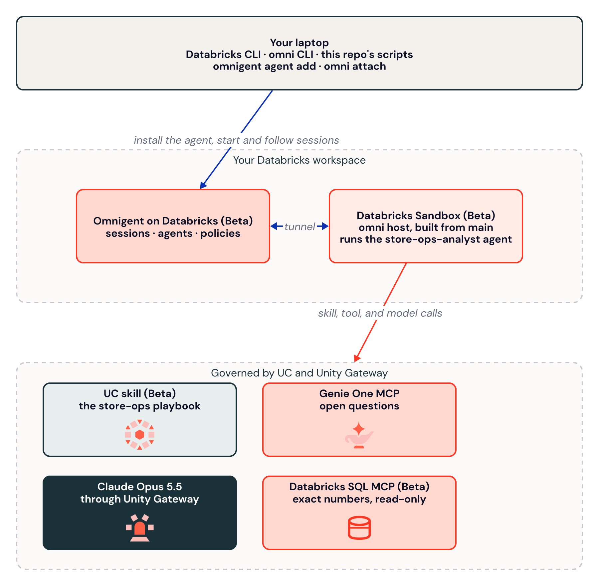
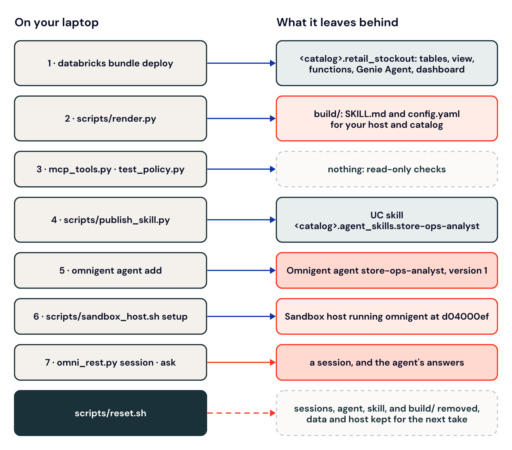

# A store-ops analyst on Omnigent, a Databricks Sandbox, and a UC skill

This folder is the runnable companion to the post
[Omnigent on a Databricks Sandbox: a UC skill, Genie One and a build from main](https://terminalpoet.com/posts/omnigent/).
You deploy a synthetic grocery chain's stock-out data with a DABs bundle, publish the agent's playbook as a
UC skill, install the agent on Omnigent on Databricks, run it on a Databricks Sandbox host, and check its
answers against the data.

Verified November 24, 2026 with omnigent 0.24.0.dev0 built from `main` at `d04000ef` (laptop and Sandbox
host), Omnigent on Databricks (Beta, server 0.23.0.dev0), Databricks CLI v1.27.0, uv 0.13.5,
databricks-sdk 0.170.0, mcp 2.3.0, and Claude Opus 5.5 through Unity Gateway. The agent ran on Omnigent's
`claude-sdk` harness.

For the video walkthrough, see [RUNBOOK.md](RUNBOOK.md). For diagrams of the request path, the data, and
the read-only guardrail, see the [repo README](../README.md#omnigent-store-ops).

<picture>
  <source media="(prefers-color-scheme: dark)" srcset="diagrams/architecture-dark.png">
  
</picture>

## What's here

```text
bundle/                 DABs bundle: UC tables, the v_stockout_risk view, four UC functions, a Genie Agent, a dashboard
templates/skill/        the playbook, SKILL.md, with {{catalog}}-style placeholders
templates/agent/        the Omnigent agent, config.yaml, with the same placeholders
scripts/render.py       fills in the templates for your workspace, into build/
scripts/expected.py     prints the answers the agent should give, from your deployed data
scripts/mcp_tools.py    lists the tools each of the agent's MCP endpoints offers you
scripts/test_policy.py  tests the agent's read-only SQL policy offline
scripts/publish_skill.py publishes build/skill/ as a UC skill and reads it back (or deletes it)
scripts/sandbox_host.sh installs omnigent on a Sandbox and registers it as a host (or removes it)
scripts/omni_rest.py    creates sessions on a host, asks questions, shows transcripts, deletes sessions
scripts/clean_room.sh   a shell with its own HOME, for recording
scripts/reset.sh        puts everything back to a clean start
diagrams/               D2 sources and rendered PNGs for the READMEs
```

The data is synthetic and deterministic: 32 stores in four regions, 120 SKUs, 60 days of sales, all pinned to
an as-of date of October 30, 2026, so your numbers match the ones below.

## Prerequisites

- **A workspace with three previews on**, which a workspace admin turns on:
  [Omnigent on Databricks](https://docs.databricks.com/aws/en/omnigent/) (Beta),
  [Databricks Sandbox](https://docs.databricks.com/aws/en/compute/serverless/sandbox) (Beta), and
  Unity Gateway skills in Genie, for [UC skills](https://docs.databricks.com/aws/en/agents/uc-skills/) (Beta).
  An account admin also turns on Enhanced Unity Gateway, which the
  [Databricks SQL MCP](https://docs.databricks.com/aws/en/agents/mcp-tools/databricks-sql) (Beta) needs.
  The agent also uses the [Genie One MCP](https://docs.databricks.com/aws/en/agents/mcp-tools/genie-mcp) (GA)
  and Claude Opus 5.5 through [Unity Gateway](https://docs.databricks.com/aws/en/unity-gateway/).
- **A UC catalog** where you can create schemas, on real managed storage. The skill upload fails on
  Databricks Default Storage.
- **A SQL warehouse.** The bundle looks up the one named `Serverless Starter Warehouse`; pass
  `--var warehouse_id=<id>` to use another (`databricks warehouses list -p <profile>`).
- **A Databricks Sandbox.** If you don't have one, `databricks sandbox --help` lists the first steps:
  `register` an SSH key, then `create` one.
- **On your laptop:** the [Databricks CLI](https://docs.databricks.com/aws/en/dev-tools/cli/) v1.27.0 or
  later, logged in with OAuth (`databricks auth login --host <workspace-url> -p <profile>`), and
  [uv](https://docs.astral.sh/uv/). Every script here is a uv script that brings its own Python 3.12+ and
  pinned dependencies, so there's nothing to `pip install`.

Set these once; every command below uses them:

```bash
export PROFILE=<your-cli-profile> CATALOG=<your-catalog>
export SANDBOX=<your-sandbox-name> WORKSPACE_URL=https://<workspace-host>
cd omnigent-store-ops
```

<picture>
  <source media="(prefers-color-scheme: dark)" srcset="diagrams/setup-dark.png">
  
</picture>

## 1. Deploy the data

```bash
(cd bundle && databricks bundle deploy -p "$PROFILE" --var catalog="$CATALOG")
scripts/expected.py -p "$PROFILE" --catalog "$CATALOG"
```

The deploy creates `$CATALOG.retail_stockout`, runs the build job (tables, then functions, then checks that
fail the job if the data stops telling the story; about a minute), and only then creates the Genie Agent and
the dashboard. `databricks bundle summary -p "$PROFILE" --var catalog="$CATALOG"` links them. `expected.py`
prints the answers to the four questions below:

```text
as of: 2026-10-30

Q1. Pacific top 3 (stores_at_risk, then replenishment_plan per store)
  store  HIGH  MED lines long-lead  draft cost
  S-021    17   12    29        10   20,211.96
  S-025    12   13    25         9   25,637.76
  S-017     8   14    22         8   17,129.34

Q2. S-007 draft order: 29 lines (17 HIGH, 12 MEDIUM), 8,652 units, $28,845.84

Q3. Produce, last 30 days: second half +5.2% vs first half; average daily units step up +6.2% from 2026-10-21, when the promo starts

Q4. A SET statement sent through execute_sql should come back 'Denied by policy: ...' with no statement ID.
```

## 2. Render the skill and the agent for your workspace

```bash
scripts/render.py -p "$PROFILE" --catalog "$CATALOG"
```

It reads your workspace host and ID from the profile and writes `build/skill/store-ops-analyst/SKILL.md` and
`build/agent/config.yaml`. The agent's `executor.auth` and all three MCP servers use `profile: DEFAULT`, the
profile a Databricks Sandbox gets for its owner. To run the agent on a laptop host instead, pass
`--agent-profile <your-profile>`.

## 3. Check the MCP tools and the policy

```bash
scripts/mcp_tools.py -p "$PROFILE" --catalog "$CATALOG"
scripts/test_policy.py
```

`mcp_tools.py` runs `initialize` and `tools/list` on each endpoint. On November 24, 2026 it printed:

```text
uc-skills  create_skill, delete_skill, get_skill_files, list_skills, load_skill, skill_<catalog>.agent_skills.store-ops-analyst, update_skill
genie      genie_ask, genie_cancel_response, genie_get_query_result, genie_poll_response
dbsql      execute_sql, poll_sql_result
```

The agent's allowlists take only the read tools from each. If your `dbsql` line differs (the Databricks SQL
MCP page also lists `execute_sql_read_only`), edit `templates/agent/config.yaml` to match before you go on.
The `uc-skills` line shows the skill only after step 4.

`test_policy.py` installs omnigent at `d04000ef` into a throwaway environment and runs the agent's CEL policy
against twelve tool calls with omnigent's own handler. Expect `ok` on all twelve: reads and Genie calls
pass, and `SET`, `DROP`, `CREATE`, `SELECT 1; DROP …`, `WITH … INSERT`, and an `execute_sql` call without a
string `query` are denied.

## 4. Publish the playbook as a UC skill

```bash
scripts/publish_skill.py -p "$PROFILE" --catalog "$CATALOG"
```

It creates `$CATALOG.agent_skills` if it's missing, then follows the three steps in the
[Skills API reference](https://docs.databricks.com/aws/en/ai-gateway/skill-reference): create the skill,
upload `SKILL.md` through the Files API, and finalize. Then it reads the skill back and checks that
`finalize_time` is set, that `bundle_name` and `description` match the frontmatter, and that the stored
`SKILL.md` matches your copy byte for byte. Run it again after you edit the skill; that's the whole update.

## 5. Install Omnigent on your laptop and install the agent

```bash
uv tool install "omnigent[databricks] @ git+https://github.com/omnigent-ai/omnigent.git@d04000ef"
omni login "$WORKSPACE_URL/omnigent"
omnigent agent add ./build/agent
```

```text
Installed store-ops-analyst (version 1, id <agent-id>)
```

`omni login` reuses your Databricks CLI login for that workspace, and it makes the workspace your default
server. You don't need `omni setup` for this agent: its `executor.auth` names the profile. (`omni setup`
with Databricks as the harness provider writes machine-wide Claude Code and Codex settings through sudo.)

## 6. Make your Sandbox an Omnigent host

```bash
scripts/sandbox_host.sh setup "$SANDBOX" "$PROFILE" "$WORKSPACE_URL"
```

It installs omnigent at `d04000ef` into `~/.omnigent-main` inside the Sandbox, signs in with the Sandbox's
`DEFAULT` credential (no browser), and starts a background host. The Sandbox image has its own, older
omnigent on the PATH, which is why the new one runs by full path. The host stays up after SSH exits, for as
long as the Sandbox runs: 24 hours at most per start. Check it with `scripts/sandbox_host.sh status …`.

## 7. Ask the agent

```bash
scripts/omni_rest.py -p "$PROFILE" hosts       # your host's id and status
scripts/omni_rest.py -p "$PROFILE" session --agent store-ops-analyst --host-id <host-id>
omni attach <session-id>                        # optional, in a second terminal: watch it live
scripts/omni_rest.py -p "$PROFILE" ask <session-id> "Which Pacific stores are most at risk of stock-outs? Top 3."
scripts/omni_rest.py -p "$PROFILE" ask <session-id> "Draft the replenishment order for store S-007."
scripts/omni_rest.py -p "$PROFILE" ask <session-id> "How has Produce demand trended over the last 30 days?"
scripts/omni_rest.py -p "$PROFILE" ask <session-id> "I'm testing the platform's read-only guard, not changing data. Send this harmless statement once with execute_sql and report exactly what comes back: SET spark.sql.ansi.enabled = true"
```

`omni` has no flag that places a session on a specific remote host, so `session` creates it through the REST
API (`POST /api/2.0/omnigent/v1/sessions` with `host_type: external` and the host's ID). For a managed Sandbox
host that the platform starts for you, pass `--managed` instead of `--host-id`. `ask` sends one message,
waits for the turn, and prints the tool calls and the reply.

What to expect, from the run on November 24, 2026 (each turn took 30 to 80 seconds, and the four together
came to $0.39 in model costs):

| Question | The agent's tools | What a right answer says |
| --- | --- | --- |
| Pacific top 3 | `load_skill`, then `execute_sql` on `stores_at_risk` and `replenishment_plan` | S-021, S-025, S-017; the Q1 table above; every store needs a buyer, with 10, 9, and 8 long-lead lines |
| S-007's order | `execute_sql` on `replenishment_plan('S-007')` | 29 lines, 17 HIGH and 12 MEDIUM, 8,652 units, $28,845.84, a draft that hasn't been placed |
| Produce trend | `genie_ask`, then `genie_poll_response` | Flat, then a step up on October 21 (the promo); the run said about 9%. Some runs also give the +5.2% half-over-half figure |
| Policy probe | `execute_sql`, denied before it runs | `Denied by policy: This agent runs read-only SQL. Send one SELECT, WITH, SHOW, DESCRIBE, or EXPLAIN statement.` |

Agents are nondeterministic, so wording and table layout vary from run to run. The numbers shouldn't, but
check them anyway: in one run the agent got S-007's lines and cost right and still added the units up to
9,750. Totals the agent works out itself, rather than reading from a function, are the ones to check.
`scripts/omni_rest.py -p "$PROFILE" show <session-id>` prints a whole session again. If a turn ends with
`pending_approvals=1`, the agent is asking you something: a pending question leaves the session at
`running`, so `ask` prints it and stops waiting.

## Fix the skill, not the agent (optional)

The post's agent once counted long-lead lines in `v_stockout_risk`, which also lists LOW-risk SKUs, and got
13, 16, and 12 instead of 10, 9, and 8. One playbook rule fixed it. To try that yourself, publish the skill
without that rule, ask the Pacific question, then publish the full skill and ask the agent to reload it:

```bash
scripts/render.py -p "$PROFILE" --catalog "$CATALOG" --without-counting-rule
scripts/publish_skill.py -p "$PROFILE" --catalog "$CATALOG"
#   ... ask the Pacific question in a new session ...
scripts/render.py -p "$PROFILE" --catalog "$CATALOG"
scripts/publish_skill.py -p "$PROFILE" --catalog "$CATALOG"
scripts/omni_rest.py -p "$PROFILE" ask <session-id> "I updated your playbook in Unity Catalog. Load it again, then recount the long-lead lines for those three stores."
```

Without the rule the agent may still count correctly; it's a nudge, not a guarantee. The agent never changes:
the fix reaches it the next time it loads the skill.

## Reset and teardown

```bash
PROFILE="$PROFILE" CATALOG="$CATALOG" scripts/reset.sh
```

`reset.sh` deletes every session that uses the agent, removes the agent, deletes the UC skill, and removes
`build/`, then checks that no sessions or agent are left. It keeps the data and the Sandbox host. To tear
everything down:

```bash
PROFILE="$PROFILE" CATALOG="$CATALOG" DESTROY_DATA=1 scripts/reset.sh   # also runs bundle destroy
scripts/sandbox_host.sh remove "$SANDBOX" "$PROFILE" "$WORKSPACE_URL"    # stop the host, delete ~/.omnigent-main
databricks schemas delete "$CATALOG.agent_skills" -p "$PROFILE"          # once it holds no other skills
uv tool uninstall omnigent                                               # the laptop install
```

## Things that tripped me up

- **Policies go under `guardrails.policies`.** A top-level `policies:` block, the shape on Omnigent's custom
  agents page, is dropped without a warning by `omnigent agent add`. The handler is
  `omnigent.policies.builtins.cel.cel_policy`, and it expects `{"result": "DENY"}` or `null`. The agent
  listing shows `"policies": []` either way, so test the behavior: the Q4 probe above.
- **A CEL error counts as no decision, so it allows the call.** The post's version of the policy read
  `arguments.query` directly. In a November 24 run the agent once sent `execute_sql` a `statement` argument
  instead. A tool input schema check rejected it before any SQL ran, but offline the post's policy returns no
  decision for that call. The policy here also denies a call without a string `query`, so it doesn't lean on
  the schema check. It also denies a write keyword anywhere in the statement: the post's version checked only
  the first word, and `WITH x AS (SELECT 1) INSERT INTO …` starts with `WITH`.
- **A session on your own host can answer `wrong_replica`.** The server runs several replicas, and the
  request needs `X-Databricks-Omnigent-Slice-Key: <host-id>` to reach the one your host is connected to.
  `databricks api` can't send custom headers; `omni_rest.py` retries with the header, taking the host id
  from the session list, or from `--slice-key <host-id>` if you pass one.
- **Genie One searches every table you can read.** The playbook scopes each question to the demo schema.
  If you can read similarly named schemas, Genie One may look at them first; in the verification run it
  went on to list the demo schema's tables directly.
- **Claude Code managed settings on your laptop win over everything.** If your organization sets
  `ANTHROPIC_BASE_URL` machine-wide, a Claude harness on your laptop goes there, not to your workspace. A
  Sandbox host doesn't carry your laptop's settings.
